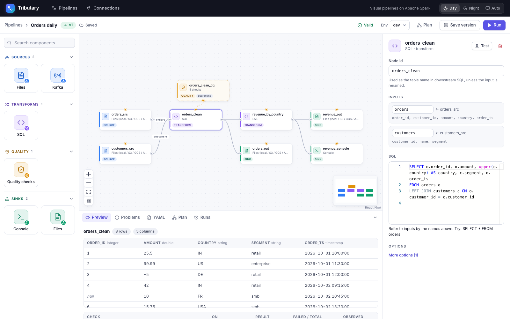
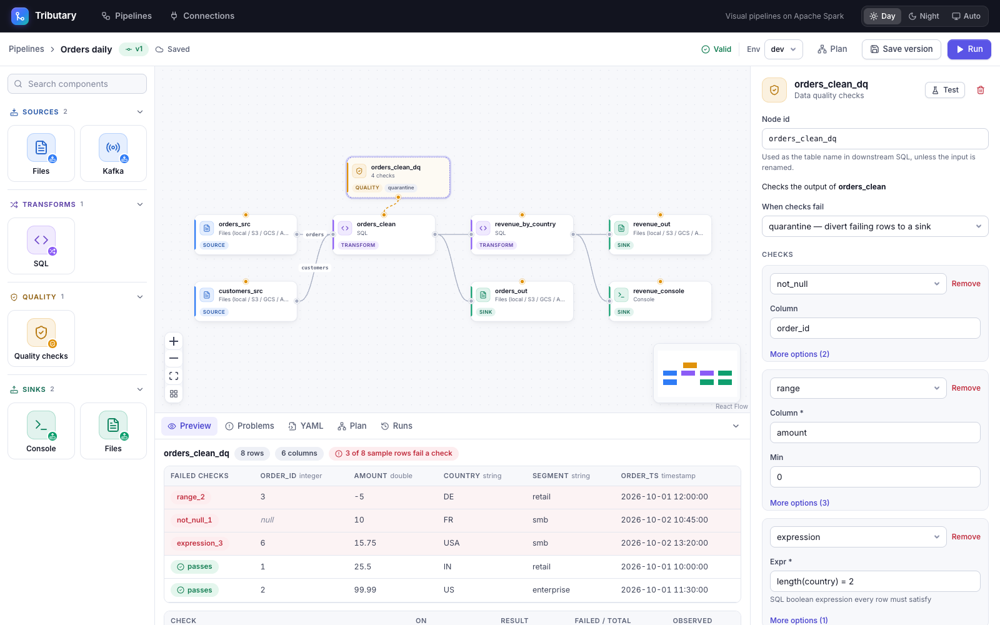
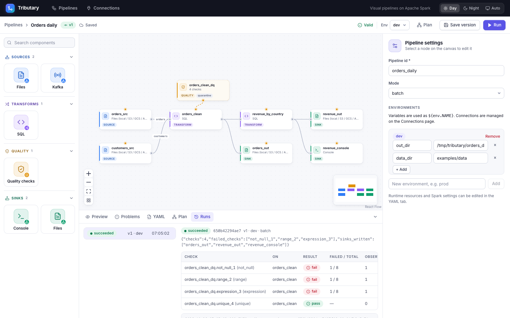

# Tributary

**Draw it. Preview it. Ship it.** An open-source platform for visual, config-driven data pipelines on Apache Spark.

You draw a pipeline as sources → transforms → sinks, with data-quality gates attached wherever you need them, and test every step on sample data as you go. The canvas produces a declarative spec; the engine validates it, plans it and runs it on Spark in batch or streaming. Phase 2 adds an AI assistant that draws pipelines from chat.

<picture>
  <source media="(prefers-color-scheme: dark)" srcset="docs/images/editor-dark.png">
  
</picture>

## Features

- **Draw, don't code.** Drag sources, transforms, quality checks and sinks onto a canvas and connect them. Every node's settings form is generated from its plugin, so new connectors show up in the UI without frontend work. See [`ui/README.md`](ui/README.md).
- **Test every step.** Press *Test* on any node to see its output on real or uploaded sample data. Validation runs as you type, down to column names in your SQL. See [Running pipelines locally](docs/local-development.md).
- **Data quality anywhere.** Attach checks to any node or in front of any sink. Then observe, fail the run, drop bad rows, or quarantine them with the checks they failed. See [how quality gates work](engine/README.md#how-it-works).

  

- **Versions and runs.** Drafts autosave; runs use immutable, validated versions. Each run gets its own Spark driver, with live logs and its data-quality history. See [how runs work](backend/README.md#how-runs-work).

  

- **Lakehouse and operational connectors.** Read from and write to files, Kafka (source), Apache Iceberg, Delta Lake, Apache Hudi, Elasticsearch, MongoDB and REST APIs (source and per-row enrichment), and profile or verify data with an [Amazon Deequ](https://github.com/awslabs/deequ) node. Every connector's options are in [`engine/README.md`](engine/README.md); [`examples/`](examples/) has a pipeline per connector; the [connector guides](#documentation) walk through using and testing each one.
- **Work locally.** In a pipeline's `local` environment, any source can use uploaded dummy data and any sink can be a dummy that writes nothing, so you can build and preview a whole pipeline with nothing running. When you want the real systems, one command starts only the Docker services your pipeline needs. See [Running pipelines locally](docs/local-development.md).
- **One engine, many places.** The same spec runs from the CLI, the API or the UI: batch or streaming, locally or on a cluster, with Spark resources sized automatically. See the [CLI commands](engine/README.md#commands) and the [API](backend/README.md#api-apiv1).

| Component | Status |
|---|---|
| [`engine/`](engine/): PySpark engine + CLI | **Phase 1a: usable** |
| [`backend/`](backend/): FastAPI, pipelines, connections, previews, runs | **Phase 1b: usable** |
| [`ui/`](ui/): React canvas, schema-driven forms, live validation, per-node preview, runs | **Phase 1c: usable** |

## Quickstart (UI)

```bash
docker compose -f deploy/docker-compose.yml up -d postgres
(cd engine && python3.11 -m venv .venv && .venv/bin/pip install -e .)
(cd backend && python3.11 -m venv .venv && .venv/bin/pip install -e ../engine -e . && .venv/bin/tributary-backend serve) &
(cd ui && npm install && npm run dev)     # open http://localhost:5173 and import examples/csv_to_parquet.yaml
```

More on running each part: [`backend/README.md`](backend/README.md#run-it), [`ui/README.md`](ui/README.md#run-it).

## Quickstart (CLI only)

```bash
cd engine && python3.11 -m venv .venv && .venv/bin/pip install -e ".[dev]" && cd ..
engine/.venv/bin/tributary validate examples/csv_to_parquet.yaml
engine/.venv/bin/tributary plan examples/csv_to_parquet.yaml
engine/.venv/bin/tributary preview examples/csv_to_parquet.yaml --node orders_clean --limit 5
engine/.venv/bin/tributary run examples/csv_to_parquet.yaml
```

Every command and its options: [`engine/README.md`](engine/README.md#commands).

Requires Java 8/11/17 and Python 3.10–3.12, which is what PySpark 3.5 supports. The Iceberg runtime defaults to 1.6.1 for the same reason (newer releases need Java 11+; pick one with `TRIBUTARY_ICEBERG_VERSION`).

## Working locally

Two ways, which you can mix node by node; both are covered step by step in [Running pipelines locally](docs/local-development.md):

- **Dummy data, nothing running.** Pick the `local` environment in the editor, then turn on *Use dummy data* on a source (upload JSON Lines, up to 1,000 records) or on a sink (it writes nothing, and Preview shows what it would get). See [dummy data](docs/local-development.md#option-b-dummy-data).
- **Real services in Docker.** Start only what your connectors need, and get the connection settings to paste into the pipeline. See [Docker services](docs/local-development.md#option-a-real-services-in-docker).

```bash
python3 scripts/local_services.py up mongodb kafka                                  # or: up all
engine/.venv/bin/python scripts/local_services.py up --pipeline examples/csv_to_mongodb.yaml
python3 scripts/local_services.py env mongodb kafka                                 # connections for environments.local
```

## A pipeline

```yaml
pipeline: { id: orders_daily, mode: batch }
environments:
  dev: { vars: { out: /tmp/out } }
sources:
  - id: orders_src
    type: file
    options: { path: data/orders.csv, format: csv, read_options: { header: true } }
    schema: { kind: ddl, ddl: "order_id INT, amount DOUBLE, country STRING" }
transforms:
  - id: orders_clean
    type: sql
    inputs: [{ node: orders_src, as: orders }]          # "orders" is the table name in SQL
    options: { sql: "SELECT order_id, amount, upper(country) AS country FROM orders" }
quality:
  - id: orders_dq
    attach_to: orders_clean                             # or `before: <sink>` to guard one sink
    action: quarantine                                  # observe | fail | drop | quarantine
    checks:
      - { type: not_null, column: order_id }
      - { type: range, column: amount, min: 0 }
    results_sinks: [{ type: console }]
    quarantine_sink: { type: file, options: { path: "${env.out}/bad" } }
sinks:
  - id: orders_out
    type: file
    input: orders_clean                                 # sinks read the business node, not the gate
    options: { path: "${env.out}/orders" }
```

See [`engine/README.md`](engine/README.md#how-it-works) for how it works, and [`docs/writing-a-plugin.md`](docs/writing-a-plugin.md) to add a connector.

## Documentation

| Guide | What it covers |
|---|---|
| [Running pipelines locally](docs/local-development.md) | The `local` environment, dummy sources and sinks, starting Docker services per connector, wiring them into a pipeline |
| [Engine](engine/README.md) | CLI commands, how compiling, planning, quality gates and execution work, every connector's options, known limits |
| [Backend](backend/README.md) | Running the API, its endpoints, connections and secrets, how runs work |
| [UI](ui/README.md) | Running the editor, what it does, code map |
| [Writing a plugin](docs/writing-a-plugin.md) | Adding a source, transform, sink or check: interfaces, registration, contract tests |
| [Examples](examples/) | A ready-to-run pipeline for each connector |

**Connector guides**: how to set up, use and test each connector locally.

| Connector | Guide |
|---|---|
| MongoDB (source and sink) | [`docs/mongodb.md`](docs/mongodb.md) |
| Elasticsearch source | [`docs/ES_AS_A_SOURCE.md`](docs/ES_AS_A_SOURCE.md) |
| Elasticsearch sink | [`deploy/elasticsearch/README.md`](deploy/elasticsearch/README.md) |
| Delta Lake source | [`docs/DELTA_AS_A_SOURCE.md`](docs/DELTA_AS_A_SOURCE.md) |
| Apache Hudi source | [`docs/HUDI_AS_A_SOURCE.md`](docs/HUDI_AS_A_SOURCE.md) |
| Apache Iceberg source | [`docs/iceberg-source.md`](docs/iceberg-source.md) |
| REST API source and enrichment | [`docs/REST_AS_A_SOURCE.md`](docs/REST_AS_A_SOURCE.md) |

The Delta, Iceberg and Hudi sinks are described in [`engine/README.md`](engine/README.md#how-it-works). For Kafka and files, start from [`examples/kafka_to_parquet.yaml`](examples/kafka_to_parquet.yaml) and [`examples/csv_to_parquet.yaml`](examples/csv_to_parquet.yaml).

The screenshots above are generated: with the backend and UI running, `node scripts/capture-screenshots.mjs` recreates them (it needs Google Chrome).
